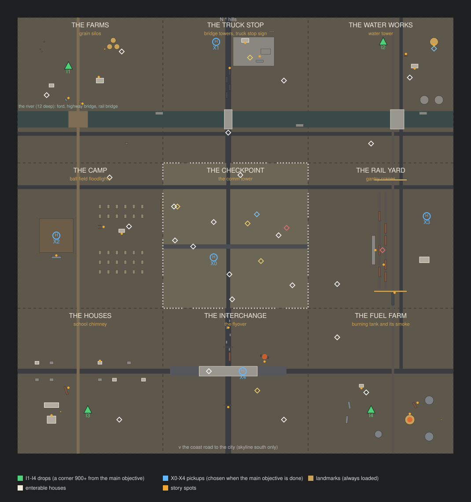

# Checkpoint Delta XL: the big grey test map (2026-11-18)

**Status: built from code, behind a switch, not yet seen in Studio.** Plan steps 1 and 2 of the
approved big-map plan (below). Owner, 2026-11-18: "the current map we have was made in Fable
5.2 and we don't have that anymore. Use the current map as a reference seed as you build the
rest of the map. You can add your own things to make it more lore accurate."

The picture is drawn from the same data the game builds (`lune run
assets/maps/build/delta_xl_topdown`). Green triangles are drops, blue circles pickups,
gold landmarks, white-edged boxes enterable houses, amber dots story spots, diamonds
objective sites.

## How to play it

- **One session:** Studio, Checkpoint Delta, Rojo as usual, Play. F1 opens the dev panel:
  RUN > THE BIG MAP > "Big map on (restarts the run)". The fence opens, the outer areas build
  (a second or two), the skyline moves south and a fresh run drops the squad at a corner.
  TELEPORT > THE BIG MAP jumps to every drop and pickup. Stop goes back to today's map.
- **Every session:** in `src/shared/Config.luau` set `DeltaXL.Enabled = true`, Stop, Play.
- Off (the default) the game is exactly today's Delta. Nothing here is in the live game until
  the PR is merged, switched on and published.

## What it is

- **1,800 x 1,800 studs**, nine 600 x 600 squares. The middle one is **today's in-game Delta,
  unchanged** (not Delta v2: v2 is a Blender proposal whose kit needs uploading, colliders and
  pathing work first; that is plan step 4). Its fence stays, opened where roads leave and
  where the crowd broke out (12 gaps), so the base still reads as a base.
- Everything outside is **plain grey Parts built by code** (`src/server/DeltaXL.luau` from the
  data in `src/shared/DeltaXLLayout.luau`). Why not a Blender generator: grey blocks need no
  meshes, so a Luau builder needs no upload and no Studio step, and enterable houses come
  from the same building kit as the base (doors, stairs, footprints the spawner and the
  Infected's stair-chase already understand). Real art replaces them area by area (step 5).
- **Roads:** the highway on x = -30 (it lines up with the Gate lane and today's main road)
  south to the coast and north over the river; the farm road (z 420), the ring road (z -560)
  rising over the highway on the flyover, the base's north road carried out east and west
  (z 200), the dirt track (x -650) and the rail service road (x 684). Together they ring the
  base for the ATV.
- **The river** (z 446..514) crosses the whole map, 12 deep with banks nobody climbs out of.
  Three crossings: the **ford** (on foot; the dirt track), the **highway bridge**, the **rail
  bridge**. Anyone who falls in walks out at the ford or up one of three boat ramps.
- **Streaming:** ground, roads, river, bridges, flyover, edge walls and every landmark are one
  Persistent model (`workspace.DeltaXL`), always loaded; houses, vehicles, tents and the rest
  (`workspace.DeltaXLBlocks`) stream by distance. The skyline is pushed south past the edge.
- **Size of it:** about a hundred always-loaded Parts (counted from the data); the blocks,
  tents and 14 enterable houses stream. Exact counts print at boot (`[DeltaXL] the big map
  is built: ...`); not yet read in Studio.

## Design note (lore developer + level designer, 2026-11-18)

Delta is the army checkpoint on the highway out of the city: everyone leaving was screened
here. It fell from the inside. The outer areas are where the overflow went when the pens
filled, and where the army's support ran from. Plain names only (`docs/LORE.md` > Naming).
**Canon flag for the owner:** the plan's river runs east-west across the north of Delta; the
Plot's map has the Harlan River running north-south down the west side. Proposal: this is a
side river that joins it to the west, called just "the river". The lore developer writes it
into `docs/lore/world_map.md` once you say yes.

| Area | What happened when the city fell | Landmark | Story spots |
|---|---|---|---|
| The farms (NW, drop I1) | The army billeted families from the overflow in the farm's barn. When the Gate shut they tried to cross the ford north with everything they could carry. | Grain silos | The barn's cots under a red cross on the roof; a tractor's trailer stacked with suitcases, stuck at the ford; screening wristbands on a family car's dashboard |
| The truck stop (N, pickup X1) | The last fuel stop north; the convoy meant to carry the cleared north stalled here and the diner became the waiting room. | The highway bridge's towers, the truck stop sign | The diner's windows boarded from the inside; the last convoy truck, tailgate down, empty; a tanker with its hose still in the ground tank |
| The water works (NE, drop I2) | The army chlorinated the camp's water here; the pump crew stayed on to keep it running. | The water tower | Chlorine drums with army stencils; a bunk room in the pump house; a rope hanging from the tower's rail |
| The camp (W, pickup X2) | When the pens filled, the overflow was put in tents on the town ball field. It turned first in the aid tent, inside the wire. | The ball field's floodlights | The aid tent; suitcases on the bleachers with names chalked on them; the food line's tables, trays still out |
| The rail yard (E, pickup X3) | Supplies came in by rail; the last train out was a hospital train that never left. | Two gantry cranes | Cots in the open wagons; stretchers on the loading platform; the locomotive's cab door open, the engine cold |
| The houses (SW, drop I3) | The first street outside the Gate; families sheltered in the school gym waiting for the buses. The search teams marked the houses they had cleared. | The school's boiler chimney | WAITING FOR BUSES on a sheet in the gym; a red X on a front door; the school bus that came for them, on its side |
| The interchange (S, pickup X4) | Everyone tried to reach the coast road; the army closed the interchange, then turned its roadblock round to face the city. | The flyover | The roadblock facing the city; cars with every door open; the burned bus that tried the slip road |
| The fuel farm (SE, drop I4) | The army's fuel point. Someone set a tank alight to stop them coming through. | The burning tank and its smoke column | A hand-drawn evacuation map on the site office wall; the foam truck, hoses out, abandoned; the tank that burns |

Story spots are amber cubes in this grey pass (`Config.DeltaXL.StoryMarkers`); each becomes a
prop when the area gets real art.

## Points and picking (plan section 3; `src/shared/Rules/DropPickup.luau`, spec first)

| | Where |
|---|---|
| Drops I1-I4 | the farms (-690, 700), the water works (610, 800), the houses (-610, -720), the fuel farm (560, -720) |
| Pickups X0-X4 | today's landing pad (-90, -90), the truck stop (-80, 800), the ball field (-740, 0), the rail yard field (790, 80), the flyover's deck (30, 24.8, -560) |

1. The main objective and its site are drawn as on today's map, now **as the run starts**
   (`ObjectiveService.prepare`), because the drop depends on it.
2. **Drop:** a corner at least 900 from the main site, at random (the farthest one if none is).
   The squad's pads, the bots and the insertion cutscene all go there.
3. **Side 1:** 150-450 from the drop. **Side 2:** 300+ from side 1 and within 350 of the
   straight line drop -> main. Either drawn side objective may be side 1; when nothing fits,
   the plan that misses by least.
4. **Pickup, chosen and revealed only when the main objective is done** (owner approved):
   half the time a point 400-700 from the main objective ("halfway back", the one nearest the
   drop), else all the way back (800+ from the main, never within 300 of the drop, nearest the
   drop). A pickup within 200 of the Warden is skipped. Control says where: "Pike, Control.
   The helicopter will pick you up at {place}. Move." Every number is in `Config.DeltaXL`.
- The base pad only qualifies as "halfway" when the main objective is out in an outer area
  (from a base site it is under 400 away), so with a base main the pickup is always far.
- **The Burn** on the big map is 1,200 s (`Config.DeltaXL.BurnSeconds`; 840 elsewhere). The
  Burn is not counted down by anything yet; this is the number it will use.
- **Distance readout:** the objective list already shows metres to each objective; world
  markers are now seen from 2,600 studs (was 1,200) and the extraction marker from 3,000.

## Objective sites on the big map (`ObjectiveDefinitions` > `delta_xl`; data only)

Every site of today's Delta is kept (`Of = "delta"`: Sanitize the Pens and Silence the Alarm
stay its signature). Added: Secure the Site at the truck stop and the interchange; Restore
Comms at the water tower; Confirm Casualties at the freight wagons; Lights On at the fuel
farm, the water works and the camp (grey lamp posts next to each); a Misdrop spot in each of
the eight areas; Clear the Spitters on the flyover, at the bridge and at the grain silos.

## What breaks (step 3, not in this PR)

- **Infected cross the map in straight lines.** Spawns ring the squad (now anywhere inside
  892), but anything left behind keeps walking straight at its target: it hits the base fence
  or drops into the river channel and stays there, filling the live cap. Needed: despawn
  Infected 450+ from everyone, remove any stuck 20 s, spawn only on the target's side of the
  river.
- **A split squad shares one 44 cap and one spawner** that rings a random member: two groups
  far apart each get half the pressure at best.
- **Respawns land at the drop corner**, possibly 1,000+ studs from the squad.
- **Bots** walk the whole way and teleport when stuck; they do not ride the ATV.
- The flyover's ramps have no side walls (a 24-stud fall off the sides near the top).
- The Warden still walks from the Gate when `Config.Objectives.Boss.Enabled = false`.
- Not measured: frame rate with four clients, memory, how long a real run takes.

## Next

1. **Owner plays it** (dev panel), says what reads wrong, and times a run.
2. Step 3, spawning at scale (the list above), then a four-client performance check.
3. Step 4, Delta v2 in the middle; step 5, real art two areas at a time (the story spots
   become props); step 6, road encounters (wreck jams, the stuck convoy, a Hocker nest on the
   flyover, holding the bridge).

## Plan (approved 2026-11-18)

Owner decisions: grow Delta to about 1,800 x 1,800; PC first (no phone cuts) but a 4-player
server must stay smooth; grey blocks first, play, then real art; the Burn 840 -> 1,200 s; the
pickup chosen and revealed only after the main objective. Travel maths: a squad crosses
1,800 studs in under 2 minutes at a run; the 15-20 minute run comes from what happens on the
way (river crossings, road fights, jams, detours), not from size alone. Build order: 1 grey
map, 2 points and picking (this PR), 3 spawning at scale, 4 Delta v2 in the middle, 5 outer
areas with real art, 6 road encounters, 7 four-client performance check.
