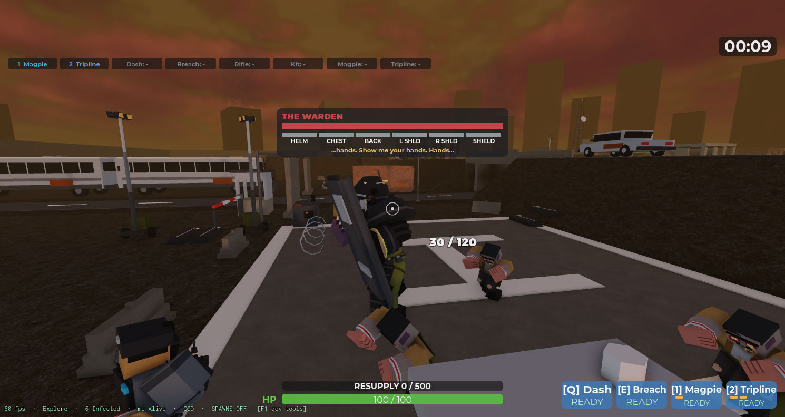
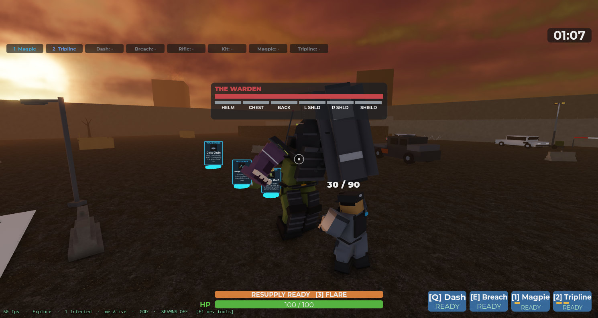
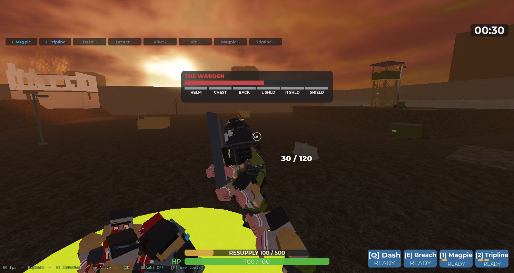

# Sprint 19 — The Warden: Delta's Index host

**Status: shipped 2026-11-07, verified in a solo playtest and a 2-client playtest (results
under the checklist). Body and animation set replaced the same day: see *v2* at the end.** The first boss, built to `docs/PROGRESSION.md` > *Index hosts* and
the sheets in `docs/CHARACTERS.md` B, `docs/LEVELS.md` A6 and `docs/LORE.md` > *Index
hosts* (2026-11-07 lore / systems / level / art passes). Completing the Primary now calls
the Warden at the Gate; he walks the screening route up the main road, and killing him is
what ends the sortie's Index step and opens extraction.

## What shipped

| # | Piece | Where |
|---|---|---|
| 1 | **Body.** `warden_limb` / `_warden_plate` builders: a Brute-scale MP in `bruise` skin and olive uniform with a white brassard, gas canisters on the belt, fists, shin guards; side-specific arms (`inf_warden_upper_arm_l/_r`, `lower_arm_l/_r`: brassard right, shield grips left). Six plate meshes (helmet, chest with the handset, back with the radio pack, shoulder dome used twice, shield). 2,588 body tris + 572 plate tris against the 5,000 boss cap. Art-director review before upload (six fixes applied). 16 meshes uploaded, ids in `assets/3d/ASSET_IDS.md`. | `assets/3d/build/build_assets.py`, `src/shared/MeshAssets.luau` (`limbMeshName` side lookup) |
| 2 | **Definition.** `EnemyDefinitions.Warden`: scale 1.9 (fits under the bridge, LEVELS A6), 7,000 hp, `Boss = true`, `Behaviour.Attack = "boss"` so `EnemyService.stepZombies` leaves him to his own service; never spawns from the wave loop. | `src/shared/EnemyDefinitions.luau` |
| 3 | **`IndexService`** (new): the fight. Plates are welded `MeshPart`s with `PlateHealth` / `PlateMax` attributes (`OriginalSize` so `ScaleTo` leaves them alone); `ItemEffectService.dealDamage` routes a hit on a plate into the plate; `ProjectileServer.hitMultiplier` applies `ArmouredMultiplier` 0.25 on a plate and `ExposedMultiplier` 1.5 on a limb whose plate is gone. A plate at `CrackFraction` cracks (pip turns yellow); at 0 it unwelds, flies off (`PlateBreakImpulse`, `Debris`), marks the limb `Exposed`, staggers him 1.5 s and fires the hit burst. Attacks with handset tells on the boss bar: Bash (90° arc, 40), Charge (anchored root along a line at 40 studs/s, hard cover = 3 s wall stun, `Probe` / `HitHeight` in Config), Gas Canister (phase 2+, `EnemyProjectileService.fire` with a puddle, at the furthest member), Guard (shield up: plates take 25% except the back, half speed; "flank him"). Phases at 60% and 25% body: the Riot Call (6 Walkers + 2 Runners, +3 Walkers per extra player, spawned one per frame), then faster charges and a faster walk. | `src/server/IndexService.luau`, `ItemEffectService.luau`, `ProjectileServer.luau`, `BotService.luau` |
| 4 | **Entry and run flow.** `RunManager`: Primary complete → `Index` state → `IndexService.start()` (radio "Index is moving at the Gate", spawn at (-30,-290), Gate-open line, five waypoints up the main road with the bus-line and Inner-Gate lines, the sighting line when a member is within 90 studs, free hunt after the Apron or 75 s). While he is up `workspace.IndexActive` makes `EnemyService` spawn slower, with a lower cap and no Brutes (`Config.Index.Warden.Pressure`). On death: radio, the priority pallet (`RequisitionService.dropCrate` upgrade cards, quiet), full heal and re-arm for the squad, `Extract` + `ExtractionService.start()`. His corpse stays 8 s (`BossCorpseLifetime`). | `src/server/RunManager.luau`, `EnemyService.luau` (`spawnBoss`, `spawnZombie` prepare hook, boss skips the billboard) |
| 5 | **Boss bar** (`BossBarUI`, new): name, body bar, six plate pips (full / cracked yellow / gone), the tell line; STYLES palette (wound, gun.l, objective yellow, friendly blue for the stun). `BossUpdate` remote: show / state / tell / hide, re-sent on request for a late joiner. | `src/client/BossBarUI.luau`, `src/shared/Remotes.luau` |
| 6 | **Co-op.** Body and plate health ×(1 + 0.33 per extra living player) at spawn (an exception to decision 6 in `docs/MULTIPLAYER_READINESS.md`: one body cannot get "more Infected"). Riot Call Walkers per extra player. Every member sees the bar and the tells. | `Config.Index.Warden.HealthPerExtraPlayer` |
| 7 | **Dev.** `SpawnWarden` (at the Gate, walking) and `WardenHere` (24 studs ahead, straight to the hunt) in the F1 panel. | `DevTestService`, `DevTestPanel` |

All numbers in `Config.Index.Warden`; animation set `Config.Animations.Infected.Warden`
(his own seven clips since v2; the mutant set at first).

## Verification

Solo (`solo_playtest`, DevCommands from client-1):

- `WardenHere`: 15 limb meshes + 6 plates load (no "keeps the bare rig" warning), plate
  sizes right on server and client (chest 3.61 wide, shield 3.95 × 7.6).
- Rifle: a plate hit takes 5 (20 × 0.25) from the plate, 0 from the body; an unplated limb
  takes 20; an exposed limb 30.
- Helmet to 0: flies off, `Head.Exposed`, 1.5 s stagger (WalkSpeed 0), tell "PLATE OFF",
  radio "Plate's off"; the pip dims. Helmet at 100/300: pip yellow, `Cracked`.
- Body to 55%: Riot Call, 8 Infected round him one per frame; charge runs with the root
  anchored and releases; Guard shows "GUARD UP: flank him".
- Death: pallet with upgrade cards at the corpse, squad healed to 100, magazine refilled,
  `IndexActive` false, bar hides after 2.5 s.
- Full flow: `ForceObjectiveComplete` → `RunState Index`, radio, the Warden walks the lane
  from (-30,-290) at 8 studs/s under the bridge with the bus-line and Inner-Gate lines, the
  sighting line on approach; kill → `RunState Extract`, extraction active.
- MicroProfiler in phase 2 (Warden + 8 Infected): 16.7 ms avg (vsync), p99 18.0 ms, no
  frame over 33 ms.

2 clients (`multiplayer_playtest`): 9,310 hp (7,000 × 1.33), plates 399 / 665 / 532 / 399 /
399 / 798; the bar is visible with six pips on both clients; the Riot Call answered 11
bodies (6 + 3 Walkers, 2 Runners); no errors on the server or either client.

Static checks: `stylua`, `selene` (0 warnings), `rojo build`, `luau-lsp analyze` (only the
pre-existing `MeshAssets` error). Performance-reviewer: pass with notes, all applied (Riot
Call spread over frames, Config'd probe / height / tell hold, no billboard on a boss, boss
corpse time, STYLES palette on the bar, hit burst on a plate break).

## Judgment calls

- **Tells are text on the boss bar** (the handset's words) plus the Brute's attack bark.
  The open-handset carrier hiss + squelch clip the lore pass asked for needs the audio
  pipeline (open work). Mapping from the lore sheet: Charge = charge, Overhead Slam and
  Shield Sweep are their own attacks since the kit expansion (were one Bash swing), Guard
  = Guard; the Gas Canister is the systems sheet's range answer; the Pound and the Stomp
  are the expansion's additions.
- **Plate cracks are a HUD pip, not a crack overlay mesh.** One shared crack mesh per plate
  shape was in the plan; the pip reads at any distance and costs nothing.
- **Scale 1.9, not 2.3** (CHARACTERS said 2.3; the bridge underside is 10.5). Reach numbers
  in Config are written at scale 1 and multiplied by `ScaleReach`.
- **The body is tougher per extra player** (0.33 each): the only Infected that is. Decision
  6 keeps "more Infected, not tougher Infected" for the roster.
- **Gate props** (chain, spray, the Gate log) and the insert / wipe radio lines from the
  lore pass are not placed yet (open work; they want Open the Route's props).

## Open work

- Handset carrier hiss + squelch tell clip and his own vocal set (audio pipeline).
- Gate dressing: the chain and spray, the MP roster with the Gate NCOIC uncrossed, insert /
  wipe radio lines.
- Perch cheese (LEVELS A14 item 7): watch whether the canister is enough.
- Phase-2 pressure with 4 players on a phone (the Riot Call at +9 Walkers).

## v2: his own body and clips (2026-11-07)

After playing the shipped Warden the owner said he liked the riot-armour direction but not
that "it's essentially just a Brute model with riot armor slapped on top". The redesign
was done live in Blender through the Blender MCP (front / side / three-quarter renders
beside a 5-stud reference man, iterated with the owner) and ported only once approved.

| # | Piece | Where |
|---|---|---|
| 1 | **Body.** Upright where the Brute hunches; asymmetric: the left side is one armoured mass (shield grown into the forearm, shoulder dome, raised riot collar), the right side the bare MP (brassard, bared forearm with the strain seam). Head sunk into the collar so helmet and shoulders read as one dome; long legs with shin guards; duty belt with the canisters. Built for the R15 rig: every limb inside its `R15_LIMB` box, sided upper arm / lower arm / hand (`SIDED`), plates as six separate meshes. 18 meshes, 2,604 tris with plates (cap 5,000), all re-uploaded. | `assets/3d/build/warden.py` (his own file: the owner's one-file-per-asset rule), `MeshAssets` Warden v2 block, `assets/3d/ASSET_IDS.md` |
| 2 | **Shield.** The first port had the shield as a slab along the forearm, which lay flat in Mixamo poses. Rebuilt as a fist-grip plate: a tall curved plate held perpendicular to the forearm just past the fist, window and band on its face, handle behind. | `warden.py` `warden_plate(L, "shield")`, `MeshAssets` offset (0, -0.85, -0.40) |
| 3 | **Clips.** Seven Mixamo clips retargeted (`retarget.py` `CLIPS`) and published: `warden_walk` (in place, 6 studs/s authored), `warden_run` (in place, 16), `warden_idle`, `warden_guard` (upper-body overlay), `warden_bash`, `warden_riot` (the roar), `warden_death`. | `assets/animations/ASSET_IDS.md`, `Config.Animations.Ids`, `Config.Animations.Infected.Warden`, `MoveClipSpeed` |
| 4 | **Wiring.** `IndexService` keeps a track table per fight: walk at Core priority rate-scaled to ground speed; idle only while the root is slower than `Config.Index.Warden.IdleSpeed` (a `MoveTo` Humanoid reports `MoveDirection` 0, so the root velocity is the test); guard as an Action overlay that `cancelGuard` stops on every action change (stagger used to leave it stuck); bash played at the rate that puts the strike at `Bash.StrikeAt` of the windup; the canister uses the throw clip; charge plays run while the root is anchored; Riot Call plays the roar over `RiotCallHold` and takes over from guard or a windup (never from a running charge); death plays the death clip. | `IndexService` `play` / `stop` / `updateIdle` / `loadTracks` / `cancelGuard`, `Config.Index.Warden` `IdleSpeed`, `Bash.StrikeAt`, `RiotCallHold` |

Verified in a solo playtest (published ids): all 21 parts wear the v2 meshes; walk at
x1.33 only while moving, idle when still; guard overlay ends with the guard; bash lands on
the tell; run while the charge winds; roar and 11 bodies at 55%; death clip on the kill;
plate break exposes the limb; priority pallet drops; 60 fps.

Open from v2: an art-director pass on the live build (the render review was done on the
Blender design, not the in-game dress).

## Kit expansion and the shield (2026-11-07, same day)

The owner played v2 and said two things: the shield "is kind of just slanted, he's not
holding it right", and "there's only two animations for this boss fight; add more
animations and give him different attacks; a ground pound should do AoE and we should get
a fall-back knockdown animation". The systems designer drew the kit (numbers in
`Config.Index.Warden`); everything below shipped and was watched in a live playtest with the
owner at the keyboard.

| # | Piece | Where |
|---|---|---|
| 1 | **Shield mount.** The v2 plate sat past the fist, perpendicular to the forearm, so in every Mixamo pose it leaned edge-on across his front. Measured in game: in the idle and the guard the left forearm lies across the chest with its outer side (limb -X) forward, so the plate is now strapped along the outer forearm, tall axis along the limb's Z, face -X: a door from eye level to shin when he guards, at his side when he walks. One mesh re-uploaded. | `assets/3d/build/warden.py` `warden_plate(L, "shield")`, `MeshAssets` (size 0.48 x 2.28 x 4.28, offset -0.67, -0.2, 0.3), `assets/3d/ASSET_IDS.md` |
| 2 | **Four new attacks.** Ground Pound (ring 6-10 studs just past the Bash, or a close-band pick: 12-stud disc on the ground, 30, knockdown 2.4 s, recovery 2.6 s so he never follows his own pound; the client draws the ring through the windup, `BossUpdate "zone"`), Shield Sweep (180° arc, 25, a 40 studs/s shove: `Impact "push"`), Overhead Slam (a reaction to a body in reach moving slower than `PlantedSpeed`: 9 x 3 line, 60), Stomp (a reaction to a body inside `HugRange` on any side: 4.5 disc, 20, knockdown 1.8 s). All at scale 1, `ScaleReach` multiplies. Bash arc 90° → 70°, Charge MinRange 15 → 19 so the ring belongs to the Pound. | `IndexService` `resolveArc` / `resolveSlam` / `resolveDisc`, `Config.Index.Warden.Pound / Sweep / Slam / Stomp` |
| 3 | **Selection: reactions, bands, a beat.** `chooseAttack` runs only after `AttackGap` (1.0 / 0.7 / 0.4 s by phase) has passed since the last recovery; reactions first (Stomp at a hugger, Guard when the plates took `TriggerPlateDamage` 150 inside `TriggerWindow` 3 s, Slam at a planted body), then the nearest member's band: hug → Bash; close → weighted {Bash 3, Sweep 2, Pound 1}, Sweep and Pound doubled with 2+ members in their shape; ring → Pound; far → Charge; perched (`PerchHeight` 4 above his feet) or beyond → Canister in any phase. Never the same attack twice except the Bash; never two knockdowns in a row. Phases shorten the Pound (11 / 8 s). | `IndexService` `chooseAttack`, `pickClose`, `allowed`, `ready` |
| 4 | **Knockdown.** `Squad.knock(member, seconds)` sets `KnockedUntil` on the character: `Squad.canAct` is false (no fire, reload, call-in, dash, breach on the server), the client holds WalkSpeed 0 (`SprintController`), refuses vaults and rolls (`MovementController`) and the trigger (`WeaponController`), and plays the fall over the first part and the get-up over the last `Config.Knockdown.GetUp` 1.0 s (`AnimationController.playKnockdown`, `KnockdownController`, `Impact "knockdown"`). `Knockdown.Grace` 1 s after standing refuses the next knockdown. Bots lie down and get up the same way (`BotService`). Still a target for the Infected while down. | `Squad`, `KnockdownController` (new), `AnimationController`, `BotService`, `Config.Knockdown` |
| 5 | **The roll now dodges him.** `EnemyProjectileService.damagePlayer(humanoid, amount, kind)`: `"melee"` is skipped inside the `CoverMoveUntil` window. The Infected claw and the Warden's limbs (Bash, Sweep, Slam, Stomp) pass it; the Pound, the Charge, splashes and puddles do not. Before this the Warden ignored the window entirely. | `EnemyProjectileService`, `EnemyService.attackIfTouching`, `IndexService` |
| 6 | **Bots read the tells.** Every ground or line attack marks its shape on workspace attributes (`BossDanger*`) through the windup; a bot inside walks out radially (disc) or sideways (line) before anything else. | `IndexService.markDanger`, `BotService.dodgeDanger` |
| 7 | **Clips.** Seven more Mixamo clips retargeted and published: `warden_pound` (Sword And Shield Jump Attack), `warden_sweep` (Cross Slash), `warden_slam` (Downward Slash), `warden_stomp` (Hard Floor Stomp), `warden_hit` (Sword And Shield Impact, on a plate break), `knockdown_back` (Knocked Out, falling to back, trimmed to the fall) and `getup_back` (Getting Up from back, trimmed to the rise). Each attack clip runs so its blow lands at `StrikeAt` of it when the windup ends. `retarget.py` gained `trim`. | `assets/animations/README.md`, `assets/animations/ASSET_IDS.md`, `Config.Animations` |

Verified (solo playtest, the owner playing, `[IndexService] <attack>` log lines): every
attack fired across one fight, bash x5 on the walk-in, charge, canister, pound (three bots
down round him), stomp, sweep and slam in phase 3, the ring on the ground, the fight ended
with the body down and the run moving on; no errors on the server or client. Not seen: a
player knockdown (the owner had God on), which is the same resolver as the bots' one.

Open from the expansion: the lore developer's handset lines for Pound / Sweep / Slam /
Stomp (placeholders in `BossBarUI.TELL_TEXT`); measure the fight length (over 130 s solo;
`Plates.Chest.Health` 500 → 400 done 2026-11-10, not yet timed in a playtest); the Sweep's shove on a client with high latency.
