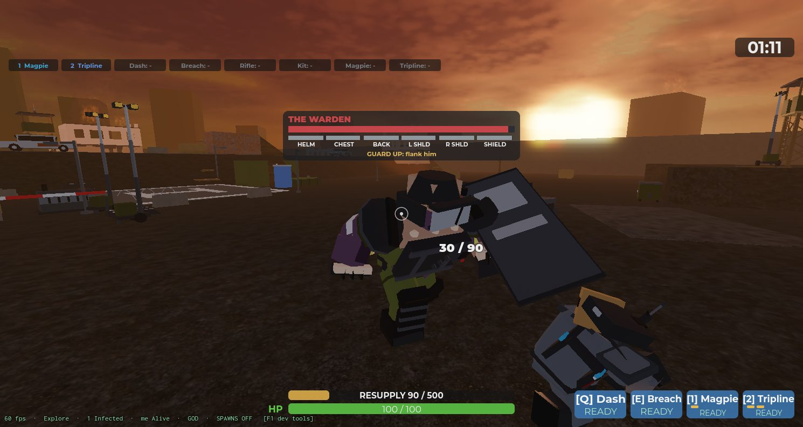
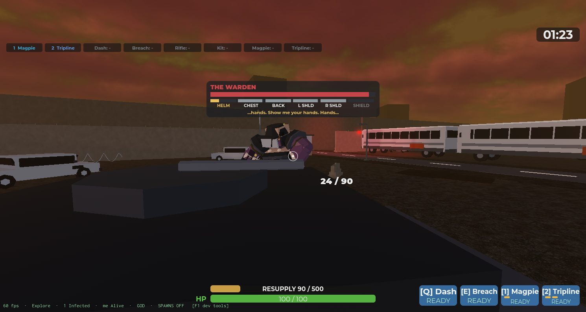

# Sprint 19 — The Warden: Delta's Index host

**Status: shipped 2026-11-07, verified in a solo playtest and a 2-client playtest (results
under the checklist).** The first boss, built to `docs/PROGRESSION.md` > *Index hosts* and
the sheets in `docs/CHARACTERS.md` B, `docs/LEVELS.md` A6 and `docs/LORE.md` > *Index
hosts* (2026-11-07 lore / systems / level / art passes). Completing the Primary now calls
the Warden at the Gate; he walks the screening route up the main road, and killing him is
what ends the sortie's Index step and opens extraction.

## What shipped

| # | Piece | Where |
|---|---|---|
| 1 | **Body.** `warden_limb` / `_warden_plate` builders: a Brute-scale MP in `bruise` skin and olive uniform with a white brassard, gas canisters on the belt, fists, shin guards; side-specific arms (`inf_warden_upper_arm_l/_r`, `lower_arm_l/_r`: brassard right, shield grips left). Six plate meshes (helmet, chest with the handset, back with the radio pack, shoulder dome used twice, shield). 2,588 body tris + 572 plate tris against the 5,000 boss cap. Art-director review before upload (six fixes applied). 16 meshes uploaded, ids in `assets/3d/ASSET_IDS.md`. | `assets/3d/build/build_assets.py`, `src/shared/MeshAssets.luau` (`limbMeshName` side lookup) |
| 2 | **Definition.** `EnemyDefinitions.Warden`: scale 1.9 (fits under the bridge, LEVELS A6), 7,000 hp, `Boss = true`, `Behaviour.Attack = "boss"` so `EnemyService.stepZombies` leaves him to his own service; never spawns from the wave loop. | `src/shared/EnemyDefinitions.luau` |
| 3 | **`IndexService`** (new): the fight. Plates are welded `MeshPart`s with `PlateHealth` / `PlateMax` attributes (`OriginalSize` so `ScaleTo` leaves them alone); `ItemEffectService.dealDamage` routes a hit on a plate into the plate; `ProjectileServer.hitMultiplier` applies `ArmouredMultiplier` 0.25 on a plate and `ExposedMultiplier` 1.5 on a limb whose plate is gone. A plate at `CrackFraction` cracks (pip turns yellow); at 0 it unwelds, flies off (`PlateBreakImpulse`, `Debris`), marks the limb `Exposed`, staggers him 1.5 s and fires the hit burst. Attacks with handset tells on the boss bar: Bash (90° arc, 40), Charge (anchored root along a line at 40 studs/s, hard cover = 3 s wall stun, `Probe` / `HitHeight` in Config), Gas Canister (phase 2+, `EnemyProjectileService.fire` with a puddle, at the furthest member), Guard (shield up: plates take 25% except the back, half speed; "flank him"). Phases at 60% and 25% body: the Riot Call (6 Walkers + 2 Runners, +3 Walkers per extra player, spawned one per frame), then faster charges and a faster walk. | `src/server/IndexService.luau`, `ItemEffectService.luau`, `ProjectileServer.luau`, `BotService.luau` |
| 4 | **Entry and run flow.** `RunManager`: Primary complete → `Index` state → `IndexService.start()` (radio "Index is moving at the Gate", spawn at (-30,-290), Gate-open line, five waypoints up the main road with the bus-line and Inner-Gate lines, the sighting line when a member is within 90 studs, free hunt after the Apron or 75 s). While he is up `workspace.IndexActive` makes `EnemyService` spawn slower, with a lower cap and no Brutes (`Config.Index.Warden.Pressure`). On death: radio, the priority pallet (`RequisitionService.dropCrate` upgrade cards, quiet), full heal and re-arm for the squad, `Extract` + `ExtractionService.start()`. His corpse stays 8 s (`BossCorpseLifetime`). | `src/server/RunManager.luau`, `EnemyService.luau` (`spawnBoss`, `spawnZombie` prepare hook, boss skips the billboard) |
| 5 | **Boss bar** (`BossBarUI`, new): name, body bar, six plate pips (full / cracked yellow / gone), the tell line; STYLES palette (wound, gun.l, objective yellow, friendly blue for the stun). `BossUpdate` remote: show / state / tell / hide, re-sent on request for a late joiner. | `src/client/BossBarUI.luau`, `src/shared/Remotes.luau` |
| 6 | **Co-op.** Body and plate health ×(1 + 0.33 per extra living player) at spawn (an exception to decision 6 in `docs/MULTIPLAYER_READINESS.md`: one body cannot get "more Infected"). Riot Call Walkers per extra player. Every member sees the bar and the tells. | `Config.Index.Warden.HealthPerExtraPlayer` |
| 7 | **Dev.** `SpawnWarden` (at the Gate, walking) and `WardenHere` (24 studs ahead, straight to the hunt) in the F1 panel. | `DevTestService`, `DevTestPanel` |

All numbers in `Config.Index.Warden`; animation set `Config.Animations.Infected.Warden`
(the mutant walk / swipe / death clips for now).

## Verification

Solo (`solo_playtest`, DevCommands from client-1):

- `WardenHere`: 15 limb meshes + 6 plates load (no "keeps the bare rig" warning), plate
  sizes right on server and client (chest 3.61 wide, shield 3.95 × 7.6).
- Rifle: a plate hit takes 5 (20 × 0.25) from the plate, 0 from the body; an unplated limb
  takes 20; an exposed limb 30.
- Helmet to 0: flies off, `Head.Exposed`, 1.5 s stagger (WalkSpeed 0), tell "PLATE OFF",
  radio "Plate's off"; the pip dims. Helmet at 100/300: pip yellow, `Cracked`.
- Body to 55%: Riot Call, 8 Infected round him one per frame; charge runs with the root
  anchored and releases; Guard shows "GUARD UP: flank him".
- Death: pallet with upgrade cards at the corpse, squad healed to 100, magazine refilled,
  `IndexActive` false, bar hides after 2.5 s.
- Full flow: `ForceObjectiveComplete` → `RunState Index`, radio, the Warden walks the lane
  from (-30,-290) at 8 studs/s under the bridge with the bus-line and Inner-Gate lines, the
  sighting line on approach; kill → `RunState Extract`, extraction active.
- MicroProfiler in phase 2 (Warden + 8 Infected): 16.7 ms avg (vsync), p99 18.0 ms, no
  frame over 33 ms.

2 clients (`multiplayer_playtest`): 9,310 hp (7,000 × 1.33), plates 399 / 665 / 532 / 399 /
399 / 798; the bar is visible with six pips on both clients; the Riot Call answered 11
bodies (6 + 3 Walkers, 2 Runners); no errors on the server or either client.

Static checks: `stylua`, `selene` (0 warnings), `rojo build`, `luau-lsp analyze` (only the
pre-existing `MeshAssets` error). Performance-reviewer: pass with notes, all applied (Riot
Call spread over frames, Config'd probe / height / tell hold, no billboard on a boss, boss
corpse time, STYLES palette on the bar, hit burst on a plate break).

## Judgment calls

- **Tells are text on the boss bar** (the handset's words) plus the Brute's attack bark.
  The open-handset carrier hiss + squelch clip the lore pass asked for needs the audio
  pipeline (open work). Mapping from the lore sheet: Charge = charge, Overhead slam = Bash,
  Shield sweep = Bash (one swing for now), Guard = Guard; the Gas Canister is the systems
  sheet's range answer.
- **Plate cracks are a HUD pip, not a crack overlay mesh.** One shared crack mesh per plate
  shape was in the plan; the pip reads at any distance and costs nothing.
- **Scale 1.9, not 2.3** (CHARACTERS said 2.3; the bridge underside is 10.5). Reach numbers
  in Config are written at scale 1 and multiplied by `ScaleReach`.
- **The body is tougher per extra player** (0.33 each): the only Infected that is. Decision
  6 keeps "more Infected, not tougher Infected" for the roster.
- **Gate props** (chain, spray, the Gate log) and the insert / wipe radio lines from the
  lore pass are not placed yet (open work; they want Open the Route's props).

## Open work

- Handset carrier hiss + squelch tell clip and his own vocal set (audio pipeline).
- Warden animation set (he wears the mutant clips; an upright walk and a shield-square
  charge pose would sell the sheet).
- Gate dressing: the chain and spray, the MP roster with the Gate NCOIC uncrossed, insert /
  wipe radio lines.
- Perch cheese (LEVELS A14 item 7): watch whether the canister is enough.
- Phase-2 pressure with 4 players on a phone (the Riot Call at +9 Walkers).
